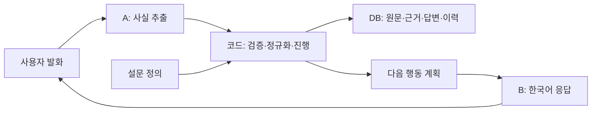
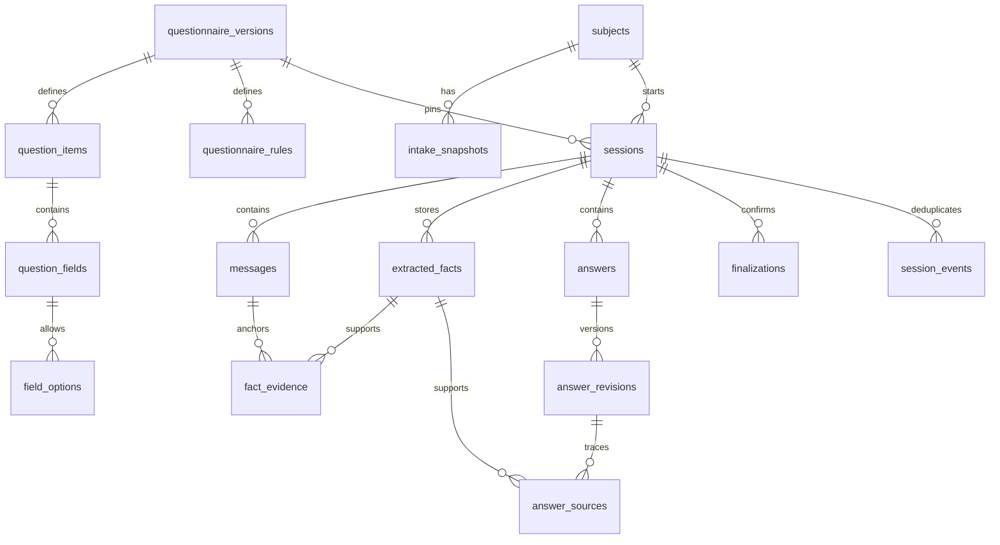

# 문진 DB·SQL 구조 설명

## 1. DB가 하는 일

이 DB는 설문 정의와 사용자 답변을 구분하고, 답변의 근거·수정 이력·최종 확인을 추적하는 SQLite 구조입니다. 문진 진행은 기존 Python 서비스가 담당합니다. DB만 열거나 SQL 정의만 실행한다고 자연어 추출·다음 질문 결정이 실행되지는 않습니다.



이번 데이터는 모델 A 출력 대신 작성한 정답 라벨을 넣어 진행 엔진으로 검증했습니다. 모델 추론이나 이번 100건의 SQLite 적재는 수행하지 않았습니다.

## 2. 동봉 참조 DB의 내용

| 항목 | 값 |
|---|---:|
| 설문 버전 | `national_health_2026_v1` |
| 정책 버전 | `prototype_policy_1` |
| 승인 상태 | `LOCAL_PROTOTYPE` |
| 테이블 | 16개 |
| 현재 답변 뷰 | `current_answers` 1개 |
| 트리거 | 8개 |
| 내부 문항 | 31개 |
| 논리 필드 | 52개 |
| 선택지 행 | 23개 |
| 규칙 행 | 70개 |
| 대상자·세션·답변 | 각각 0건 |

공식 문항 Q1~Q10의 질환별 행을 펼친 것이 내부 문항 31개입니다. 주종별 반복 필드를 펼치면 최대 68개 저장 자리가 되지만 모든 사용자에게 68개 답변을 요구하는 것은 아닙니다. 이 묶음의 완료 범위는 건강 문항이며 접수·신원정보를 포함한 기관 제출 전체가 아닙니다.

## 3. 테이블별 책임

| 구분 | 테이블 | 보관 내용 |
|---|---|---|
| 설문 정의 | `questionnaire_versions` | 문진표·정책 버전, 원문·스키마 해시 |
| 설문 정의 | `question_items` | 문항 원문·질환·질문 순서·기준 기간·PDF 위치 |
| 설문 정의 | `question_fields` | 필드명·자료형·단위·제약·반복 키 |
| 설문 정의 | `field_options` | 선택지 코드·표시명 |
| 설문 정의 | `questionnaire_rules` | 적용·필수·운영·완료 규칙과 출처·상태 |
| 대상자·접수 | `subjects` | 대상자 ID·외부 참조·합성 여부 |
| 대상자·접수 | `intake_snapshots` | 접수 당시 정보와 보호된 신원정보 참조 |
| 진행 | `sessions` | 대상자의 문진 회차·진행 상태·전체 수정 번호·재개 상태 JSON |
| 원문 | `messages` | 순서가 있는 사용자·상담자 발화 |
| 추출 | `extracted_facts` | 모델/라벨 추출 후보 원문 JSON·모델 버전·상태 |
| 추출 | `fact_evidence` | 후보가 근거로 삼은 사용자 발화와 문자 구간 |
| 답변 | `answers` | 문항 필드·반복 키별 답변 식별자와 현재 수정본 포인터 |
| 답변 | `answer_revisions` | 변경할 때마다 추가하는 값·해결 상태·적용 상태·변경 이유 |
| 답변 | `answer_sources` | 답변 수정본과 추출 후보 연결 |
| 확정 | `finalizations` | 사용자가 확인한 세션 수정 번호와 최종 확인 기록 |
| 재시도 | `session_events` | 요청 ID·입력 해시·기존 처리 결과 |



## 4. 식별자와 값 저장

- `session_id`: 한 번의 문진 회차.
- `sessions.revision`: 그 회차 전체의 수정 번호. 마지막 확인이 어느 상태를 승인했는지 구분합니다.
- `answer_id`: 회차 안에서 특정 필드·주종에 대한 답변의 식별자.
- `answer_revisions.revision_no`: 그 답변 하나의 수정 이력 번호.
- `repeat_key`: 같은 필드를 주종별로 저장할 때 쓰는 구분값. 맥주와 소주의 양은 서로 다른 답변입니다.

값은 `value_boolean`, `value_number`, `value_option`, `value_text` 중 하나에 저장합니다. 확정된 적용 가능 답변은 정확히 한 값이 있어야 하고, 비해당 답변에는 값을 넣지 않습니다. 답변을 수정하면 기존 이력을 덮어쓰지 않고 새 revision을 추가합니다.

| A 추출 표현 | DB 정규화 표현 |
|---|---|
| `Q10 / answer = 3` | `field_id=Q10.days`, `value_number=3` |
| `Q1.D03 / diagnosed = true` | 해당 진단 필드, `value_boolean=1` |
| `Q8_2 / hours=1, minutes=20` | `Q8_2.duration_minutes`, `value_number=80` |
| `Q6_1 / usage_days=2` | `Q6_1.use_pattern`, `value_option=days_1_2` |
| 맥주 수량·단위 | `Q7_1.amount`·`Q7_1.unit`, `repeat_key=beer` |

범위·근사·모름을 코드가 임의의 정확한 숫자로 채우지 않습니다. 범위의 원시 표현은 추출 후보에 보존하며 최종 답변 테이블은 선택지 매핑 또는 재질문 결과를 반영합니다.

## 5. 저장·재개·수정 흐름

기존 `QuestionnaireService`의 한 턴 처리 개요입니다. 해당 실행 코드는 이번 배포 묶음에는 포함하지 않습니다.

1. 같은 요청 ID가 이미 처리됐는지 확인합니다. 같은 내용이면 기존 결과를 돌려줍니다.
2. 요청의 `expected_revision`과 현재 세션 revision을 비교합니다.
3. A 추출 후보의 형식·근거·수정 대상을 검증합니다.
4. 진행 엔진이 상태·조건부 분기·다음 행동을 결정합니다.
5. 사용자 발화·추출 후보·근거·답변 수정본·진행 JSON·응답을 같은 트랜잭션에서 저장합니다.
6. 중간 실패 시 한 턴 전체를 롤백합니다.

`sessions.progress_json`은 재개용 상태이고 `current_answers`는 SQL 조회용 현재 답변입니다. 서비스가 둘을 함께 갱신합니다. 답변 테이블만 직접 UPDATE하면 재개 상태와 불일치할 수 있습니다.

상위 답변이 바뀌면 하위 문항 적용 여부를 다시 평가합니다. 비해당으로 바뀐 과거 답은 이력에 남기고, 다시 해당으로 바뀌어도 자동 재확정하지 않습니다. 최종 확인은 모든 적용 문항이 해결된 뒤 **같은 세션 revision**에 대해 받아야 합니다.

## 6. 상태의 구분

| 위치 | 상태/행동 |
|---|---|
| SQL 답변 해결 상태 | `UNASKED`, `PARTIAL`, `AMBIGUOUS`, `UNCERTAIN`, `REFUSED`, `DEFERRED`, `CONFLICT`, `CONFIRMED` |
| SQL 문항 적용 상태 | `APPLICABLE`, `NOT_APPLICABLE`, `WAIT_PARENT` |
| SQL 세션 상태 | `IN_PROGRESS`, `PAUSED`, `NEEDS_REVIEW`, `READY_FOR_REVIEW`, `COMPLETED` |
| 코드 행동 | `NEXT`, `CLARIFY`, `CONFIRM`, `REVIEW_INCOMPLETE`, `REVIEW_SUMMARY`, `COMPLETE` |

허용된 SQL 상태가 모두 개별 API로 구현됐다는 뜻은 아닙니다. 기존 서비스는 거절·불확실성을 `DEFERRED`로 저장하기도 하며 원래 이유는 추출 후보에서 추적합니다. 사실 상태와 진행 상태를 같은 라벨로 취급하지 않습니다.

## 7. SQL·DB 열기와 복원

DB Browser for SQLite 같은 도구에서 `db/questionnaire_reference.sqlite3`를 열면 됩니다. SQLite CLI가 설치돼 있다면 패키지 루트에서 다음을 실행할 수 있습니다.

```sh
sqlite3 db/questionnaire_reference.sqlite3
```

구조만 새 DB에 만들 때는 기본 SQL과 서비스 SQL을 순서대로 적용합니다. 이 방식은 문항·필드 초기 데이터까지 넣지는 않습니다.

```sh
sqlite3 empty_structure.sqlite3 < db/schema.sql
sqlite3 empty_structure.sqlite3 < db/service_schema.sql
```

**초기 정의 데이터까지 동일하게 복원**하려면 새 파일에 전체 덤프를 적용합니다. 앞의 구조 생성과 중복 적용하지 않습니다.

```sh
sqlite3 restored.sqlite3 < db/initialized_database.sql
```

외래키 설정은 연결마다 켜야 합니다.

```sql
PRAGMA foreign_keys = ON;
PRAGMA integrity_check;
PRAGMA foreign_key_check;
```

위 셸 리디렉션 예시는 bash 기준입니다. SQLite GUI에서도 SQL 파일을 열어 실행할 수 있습니다. 아래 Python 예시는 별도 SQLite CLI 없이 패키지 루트에서 실행할 수 있습니다.

```python
import sqlite3
from pathlib import Path

db = sqlite3.connect(':memory:')
db.executescript(Path('db/initialized_database.sql').read_text(encoding='utf-8'))
db.execute('PRAGMA foreign_keys=ON')
print(db.execute('SELECT COUNT(*) FROM question_items').fetchone())  # (31,)
```

## 8. 조회 예시

문항·필드 정의:

```sql
SELECT i.item_id, i.question_text, f.field_id, f.data_type, f.unit
FROM question_items AS i
JOIN question_fields AS f
  ON f.version_id = i.version_id AND f.item_id = i.item_id
ORDER BY i.sequence_no, f.field_id;
```

미정 정책:

```sql
SELECT rule_id, origin, description
FROM questionnaire_rules
WHERE status = 'PENDING';
```

특정 세션의 현재 답변:

```sql
SELECT field_id, repeat_key, resolution_status, applicability_status,
       value_boolean, value_number, value_option, value_text
FROM current_answers
WHERE session_id = :session_id
ORDER BY field_id, repeat_key;
```

답변 이력:

```sql
SELECT revision_no, previous_revision, value_number, change_reason
FROM answer_revisions
WHERE session_id = :session_id AND answer_id = :answer_id
ORDER BY revision_no;
```

답변에서 원문 근거 추적:

```sql
SELECT a.field_id, a.revision_no, f.raw_json,
       e.evidence_text, e.start_offset, e.end_offset, m.content
FROM answer_revisions AS a
JOIN answer_sources AS s USING (session_id, answer_id, revision_no)
JOIN extracted_facts AS f USING (session_id, fact_id)
JOIN fact_evidence AS e USING (session_id, fact_id)
JOIN messages AS m USING (session_id, message_id)
WHERE a.session_id = :session_id AND a.answer_id = :answer_id;
```

`:session_id`와 `:answer_id`는 호출 코드가 바인딩할 매개변수입니다. 동봉 참조 DB에는 세션이 없으므로 답변·이력 조회는 0행이 정상입니다.

## 9. 적용되는 제약과 남은 항목

SQL은 외래키·값 타입·선택지·수치 범위·반복 키·근거 문자열 일치·답변과 확정 이력의 수정/삭제 방지 등을 검사합니다. 최종 자연어 의미와 전체 문진 완료 조건은 서비스 검증과 별도 검수가 필요합니다. SQL 규칙 테이블의 모든 행을 자동 실행하는 범용 규칙 엔진은 아닙니다.

미정 정책은 접수 필수 범위, 수령 방식 선택 개수, 운동 0일의 시간 처리, 기타 술 분류입니다. A 계약에는 전자담배의 명시적 매일 사용을 표현할 원시 필드 확장도 남아 있습니다. 30일 사용만으로 매일을 추정하지 않습니다.

최종 확인과 주종 목록 완료는 현재 명시적 UI/API 이벤트입니다. “네”라는 발화를 자동으로 최종 확인으로 처리하는 라벨은 이번 데이터에 추가하지 않았습니다. 운영 인증·암호화·기관 승인·배포는 본 패키지 범위에 없습니다.
